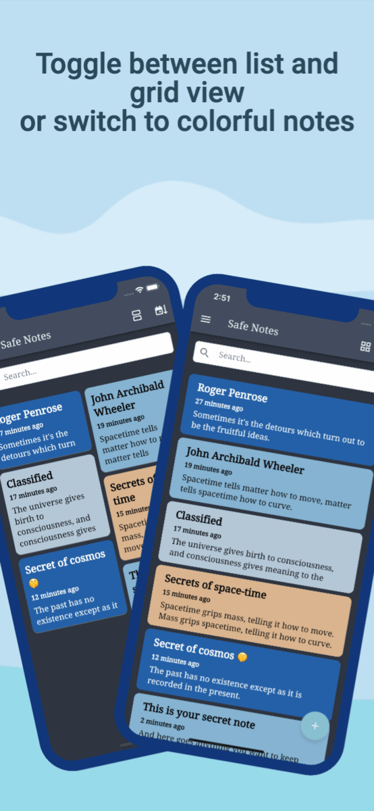

# SafeNotes

SafeNotes is a private, client-side encrypted note-taking application developed with Flutter. Designed with an offline-first architecture, it ensures that personal notes, credentials, and sensitive thoughts remain strictly confidential and protected on the local device.



---

## Key Features

- End-to-End Local Encryption: Every note title, body, and timestamp is encrypted prior to database persistence using AES-256 in CBC mode with PKCS7 padding.
- Cryptographic Key Derivation: Derives cryptographic keys and initialization vectors (IV) dynamically using secure random salts and iterated SHA-256 hashing.
- Zero-Knowledge Storage: The encryption passphrase is never stored on disk in plaintext. Authentication relies on salted cryptographic verification.
- Biometric Authentication: Supports fingerprint and face authentication via platform biometrics with brute-force prevention timeouts.
- Screen Capture Protection: Dynamically applies Android FLAG_SECURE and disables recent task thumbnails to block third-party screen recordings and screenshots.
- Inactivity and Focus Auto-Lock: Configurable session timeout monitoring locks the workspace when the app loses focus or detects prolonged user inactivity.
- Encrypted Backup and Restore: Automated local backups and encrypted JSON export/import enable seamless backup without exposing unencrypted notes.
- Offline-First Architecture: Operates entirely offline without external server dependencies, tracking scripts, or analytics.
- Extensive Customization: Offers Dark, Light, Dim, and Nord themes, configurable note color palettes, list/grid views, and compact note previews.
- Multilingual Support: Built-in internationalization covering 27 languages.

---

## Security Architecture

### 1. Data Encryption Standard
- Algorithm: Advanced Encryption Standard (AES) with a 256-bit symmetric key.
- Mode of Operation: Cipher Block Chaining (CBC) with PKCS7 padding.
- Salt Generation: Cryptographically secure pseudo-random number generator (CSPRNG) produces a unique 8-byte non-zero salt for every encryption operation.

### 2. Key and IV Derivation
- Key and IV pairs are generated using an iterative SHA-256 digest approach:
  - Iteration 1: `Hash_1 = SHA256(Passphrase + Salt)`
  - Iteration N: `Hash_N = SHA256(Hash_{N-1} + Passphrase + Salt)`
  - The concatenated hashes are segmented into a 32-byte (256-bit) encryption key and a 16-byte (128-bit) initialization vector.
- The ciphertext bundle stores the prepended random marker, salt bytes, and AES ciphertext in Base64 encoding.

### 3. Display and Memory Protection
- Android Hardware Security: Prevents screen recordings, screen captures, and snapshot rendering in the Android multitasking overview using `WindowManager.LayoutParams.FLAG_SECURE` and `setRecentsScreenshotEnabled(false)` on Android 13+ (API 33+).
- In-Memory Session Management: Unsaved note drafts are cleared or gracefully saved into the encrypted database during ungraceful app backgrounding or session terminations.

---

## Tech Stack and Dependencies

- Framework: Flutter (Channel stable, Dart SDK >= 3.0.0 < 4.1.0)
- State Management: Provider
- Persistence: SQLite via sqflite, SharedPreferences
- Cryptography: encrypt, crypto, flutter_secure_storage
- Hardware and System APIs: local_auth, local_session_timeout, device_info_plus, permission_handler
- Internationalization: easy_localization
- Visual Theme: safenotes_nord_theme

---

## Project Structure

```text
safenotes/
├── android/            # Android platform files, manifests, and build scripts
├── assets/             # Fonts, application icons, and localization bundles
│   ├── fonts/          # Embedded typography (Merriweather, NotoSerif, NotoEmoji)
│   ├── github/         # Badges and demonstration media
│   ├── images/         # Application icons and splash screen assets
│   └── translations/   # Localization JSON files for 27 languages
├── ios/                # iOS platform configurations and Xcode workspace
├── lib/                # Application source code
│   ├── data/           # SQLite database handler and preference storage
│   ├── dialogs/        # Alert modals (backup, delete, passphrases, logout)
│   ├── encryption/     # AES-256 CBC encryption and SHA-256 key derivation logic
│   ├── models/         # State models, themes, sessions, and note representations
│   ├── routes/         # Page transitions and route generator
│   ├── utils/          # Lifecycle observers, backup tasks, and formatters
│   ├── views/          # Screen views (Authentication, Home, Notes, Settings)
│   └── widgets/        # Reusable interface components and note cards
├── scripts/            # Helper automation and maintenance scripts
├── test/               # Unit and widget test suite
├── analysis_options.yaml # Linter configuration
├── pubspec.yaml        # Project dependencies and asset definitions
└── README.md           # Documentation
```

---

## Getting Started

### Prerequisites

- Flutter SDK (version 3.7.0 or higher)
- Android SDK (compileSdkVersion 36, targetSdkVersion 36, minSdkVersion 25)
- Java Development Kit (JDK 17)
- Git command-line tool

### Installation and Setup

1. Clone the repository:
   ```bash
   git clone https://github.com/Hoangnam574/Safenotes.git
   cd Safenotes
   ```

2. Retrieve dependencies:
   ```bash
   flutter pub get
   ```

3. Run on a connected device or emulator:
   ```bash
   flutter run
   ```

---

## Build Commands

- Debug APK:
  ```bash
  flutter build apk --debug
  ```

- Release APK:
  ```bash
  flutter build apk --release
  ```

- Android App Bundle (for distribution):
  ```bash
  flutter build appbundle --release
  ```

- iOS (requires macOS with Xcode):
  ```bash
  flutter build ios --release --no-codesign
  ```

---

## Testing and Quality Assurance

- Execute widget and unit tests:
  ```bash
  flutter test
  ```

- Code analysis and linting:
  ```bash
  flutter analyze lib test
  ```

- Format Dart source files:
  ```bash
  dart format --set-exit-if-changed .
  ```

---

## License

This project is licensed under the GNU General Public License v3.0 (GPL-3.0-or-later). See the LICENSE file for details.

Copyright (C) hoangnam574.
